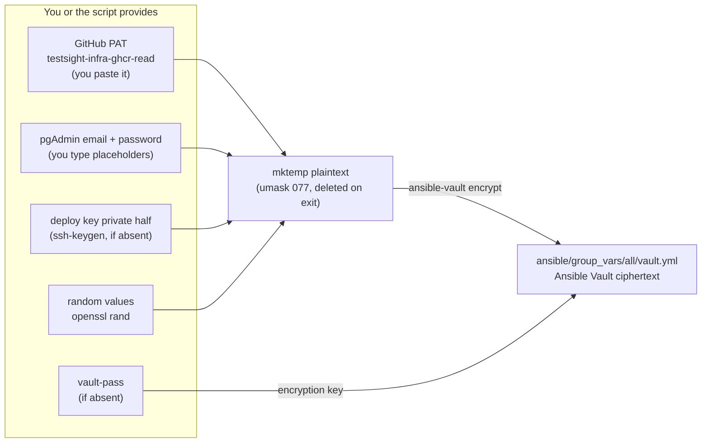
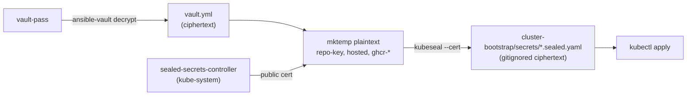
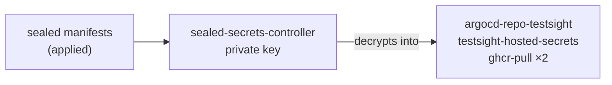

# Secrets

Every secret for the cluster lives in this repo's workflow, never in the app
repo. Two layers:

| Layer | Where | Committed |
|---|---|---|
| Generated plaintext source | `ansible/group_vars/all/vault.yml` (Ansible Vault) | encrypted only |
| Per-cluster sealed manifests | `cluster-bootstrap/secrets/*.sealed.yaml` | no (gitignored) |

A third, external layer holds upstream credentials: the GitHub PAT, the repo
deploy key, and — never in the repo — the vault password below.

The sealed manifests are **not** tracked. Ciphertext from `kubeseal` is bound to
one controller key, so a rebuilt cluster cannot decrypt old files; the vault is
the source of truth and `make seal` regenerates them. They are ignored so the
repo carries no cluster-specific material.

The vault password file lives outside the repo, for example
`~/.config/testsight/vault-pass` (mode `0600`), referenced by
`ANSIBLE_VAULT_PASSWORD_FILE`. `make secrets-init` generates one.

## How the pieces fit

Nothing is copied between services by hand except the GitHub token and the
deploy key's public half. The vault password is unrelated to any external
credential: the script makes one locally, and it only guards `vault.yml`.

The three lifecycle steps are:

1. `make secrets-init` — gather inputs and write one encrypted file.
2. `make seal` — turn that file into per-cluster sealed manifests (gitignored,
   applied straight to the cluster).
3. Runtime — the controller decrypts them into ordinary Kubernetes Secrets.

Those flows are diagrammed in the sections below.

Points worth remembering:

- `vault-pass` is a random passphrase, **not** the GitHub token. It must be
  backed up out of band; losing it makes `vault.yml` unreadable, and the vault
  is gitignored so there is no copy in the repository to fall back on.
- The token (`ghp_…`) is typed once, then exists only inside `vault.yml`
  ciphertext and the cluster's own Secrets. Nothing in git holds it.
- The deploy key private half goes into the vault (Argo uses it); only the
  `.pub` is registered on GitHub.

### Step 1 — `make secrets-init`: collect and encrypt

`cluster-bootstrap/scripts/secrets-init.sh` runs once per workstation. It
refuses to run if `vault.yml` already exists.

Outside the script, two manual follow-ups: paste `testsight-infra-deploy-key.pub`
into the app repo's deploy keys, and note the token's expiry date.

### Step 2 — `make seal`: vault to sealed manifests

`cluster-bootstrap/scripts/seal-secrets.sh` decrypts the vault into a temporary
directory, renders the Kubernetes Secrets, seals each one with the controller's
public certificate, applies it, and deletes the plaintext.

The resulting `*.sealed.yaml` files are gitignored and applied by the script.
Keep them out of git: they are per-cluster, unreadable after a rebuild, and add
nothing that `vault.yml` plus `make seal` does not already provide.

### Step 3 — runtime: cluster decrypts on demand

The controller watches the sealed manifests and materialises the plain
Kubernetes Secrets. Pods never see ciphertext; they consume the decrypted
Secrets. That is why a rebuilt cluster with a new controller key cannot read old
sealed files and requires `make seal` again.

## What lives in the vault

- `vault_postgres_password`, `vault_pgadmin_email`, `vault_pgadmin_password`
- `vault_bootstrap_api_key` (`BOOTSTRAP_API_KEY`)
- `vault_argocd_admin_password`: the Argo CD `admin` password. Sealed as a
  bcrypt hash in `argocd-secret`, never as plaintext, and rotated by
  `make seal` after `ansible-vault edit`
- `vault_ghcr_username`, `vault_ghcr_token` (GitHub classic PAT
  `testsight-infra-ghcr-read`, `read:packages` only, with an expiry to track)
- `vault_argocd_repo_ssh_key` (read-only deploy key private half for `testsight`)
- GitHub SSH host keys for Argo's known-hosts ConfigMap

## Sealed Secrets

The controller runs in `kube-system` (pinned chart version from
`cluster-bootstrap/versions.env`). Step 2 above covers the sealing flow; the
resulting Secrets are:

- `argocd-repo-testsight` in `argocd`, type `repository`, `type: git`,
  `url: git@github.com:markw77/testsight.git`, `sshPrivateKey`, and a known-hosts
  ConfigMap so host-key verification stays on. Do not use
  `insecureIgnoreHostKey`.
- `testsight-hosted-secrets` in `testsight-system` with `DATABASE_URL`
  (`postgresql+asyncpg://testsight:URL_ENCODED_PASSWORD@<host-ip>:5432/testsight`,
  matching the rendered `.env`) and `BOOTSTRAP_API_KEY`.
- `ghcr-pull` (`kubernetes.io/dockerconfigjson`) in **both** `testsight-system`
  and `testsight-runners`, because the chart's Deployment and migration Job pull
  the private control-plane image.
- `cloudflare-tunnel-token` only when a named tunnel replaces quick mode.

Order matters: namespaces, then the repository Secret, app Secret, and both
`ghcr-pull` Secrets, then the AppProject, then the root Application. The repo
credential must exist before Argo fetches `deploy/argocd/apps`.

## Rotation

1. Update the value with `ansible-vault edit ansible/group_vars/all/vault.yml`.
2. Re-run `make seal`; it re-seals and applies, and the files stay untracked.
3. Apply, then restart what consumes it:
   - `DATABASE_URL`/`BOOTSTRAP_API_KEY`: `kubectl -n testsight-system rollout restart deploy/testsight-control-plane`
   - GHCR token (`testsight-infra-ghcr-read`): the next Job pod pulls the new
     credential; restart the Deployment to re-pull immediately.
   - Argo repo key: Argo picks it up on the next refresh; `argocd app get` to
     confirm connectivity.
4. Verify `/readyz` and `GET /v1/usage` with the new bootstrap key.
5. Revoke superseded credentials at the source (GitHub deploy key, GHCR token).

The GHCR token carries an expiry date. When it lapses, image pulls fail with
`ImagePullBackOff`; rotate before the date by creating a replacement
`testsight-infra-ghcr-read`-style token and repeating this section.

## Mandatory re-seal after a cluster rebuild

A new cluster means a new Sealed Secrets controller key. Every sealed manifest
must be regenerated: `make seal` after every clean rebuild and discard the
previous sealed files (they are gitignored, so there is nothing to uncommit).
Old sealed manifests cannot be decrypted by the new controller.

## Key backup

The controller private key is the only way to decrypt the sealed manifests.
Back it up out of band (`kubectl -n kube-system get secret -l
sealedsecrets.bitnami.com/sealed-secrets-key -o yaml`) and store it off-host. A
cluster rebuild without it requires re-sealing every manifest.
